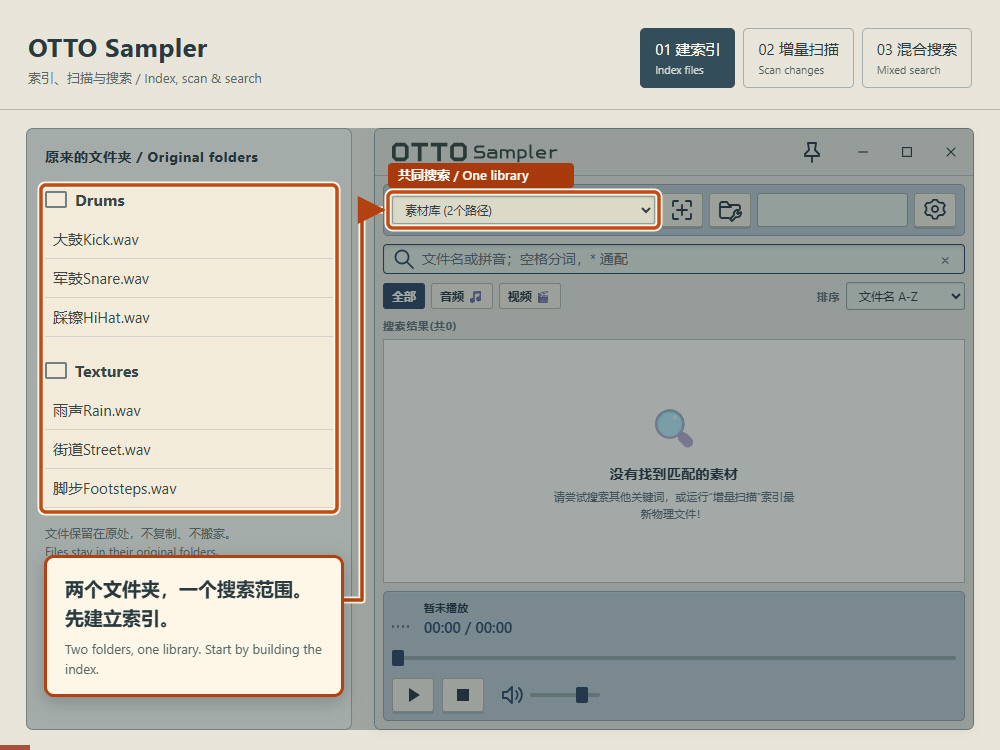
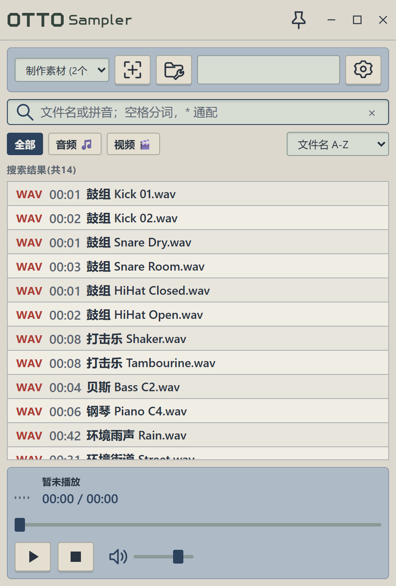
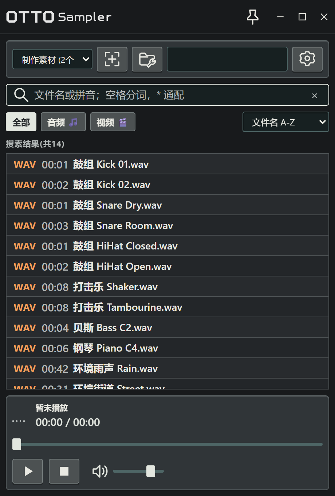

# OTTO Sampler

[简体中文](README.md) · **English**

OTTO Sampler is a local audio and video browser for Windows. Search across folders, preview sounds, and drag files into applications that accept file drops. The index stays on your computer, and your media stays in its original location.

## Quick start

Open the [latest release](https://github.com/Cliffwq/otto-sampler/releases/latest) and download an installer from **Assets**:

- [Windows x64 installer (EXE)](https://github.com/Cliffwq/otto-sampler/releases/download/v0.1.0/Otto-Sampler_0.1.0_x64-setup.exe): download, run and follow the installation steps.
- [MSI installer](https://github.com/Cliffwq/otto-sampler/releases/download/v0.1.0/Otto-Sampler_0.1.0_x64_en-US.msi): an alternative installer; choose either format.

Supports Windows 10/11 (x64) and requires Microsoft Edge WebView2 Runtime. After installation, open the app, add your media folders and scan them to start searching.

## Features

- **Chinese, pinyin and English in the same search.** Use multiple terms, partial pinyin and wildcards; examples are below.
- **Search across folders.** Save several folders as a group and search their media together. Incremental scans keep the index up to date.
- **Filtering and sorting.** Filter by audio or video; sort by filename, duration or modification time. The last sort order is remembered. Results load in batches of 200 as you scroll.
- **Drag and preview.** Drag either audio or video files from the list into other applications. Click audio to preview it; double-click video to open it in the system's default application.
- **Edge docking.** Drag the window to either side of the screen. It retracts when the pointer leaves and returns when the pointer reaches the edge. An always-on-top option is also available.
- **Four themes.** Palettes draw from the Akai MPC60, MPC2000XL, E-mu SP-1200 and Roland SP-404MKII. Each has light and dark variants, with an option to follow the system. MPC60 is the default.

### Indexing and search demo

An index is a local catalog of filenames and locations. It lets you search across folders while the files stay where they are. When a folder changes, an incremental scan checks and updates that catalog. You can then search with Chinese characters, pinyin and English in the same query, without renaming files to a single language.



The example indexes 6 files from two folders, adds 1 record after a new sound is scanned, then finds the same results with `鼓 kick`, `gukick` and `大gu kick`. The animation uses sample data to explain the workflow; it is not a scan-speed benchmark.

### Theme preview

<p>
  
  
</p>

Left: MPC60 light. Right: SP-404MKII dark. Screenshots use sample filenames. The application interface is currently in Simplified Chinese.

## Usage

1. **Add folders.** Open path management using the folder-and-wrench button. Enter a group name, add one or more folders, and save the group. You can make a frequently used group the default.
2. **Create the index.** Select the saved group in the top bar and run an incremental scan. Scan again after adding or changing media; there is no need to import the entire library again.
3. **Find and use a file.** Enter search terms, click audio to preview it, then drag a list item into the destination application. That application must support file drops and the file's format.
4. **Adjust the workspace.** Use the gear button to choose a palette, light/dark mode and startup scanning. Drag the window to a screen edge to dock it. Window size and sort preferences are restored on the next launch.

Hover over a button to see its purpose in the top hint area. Resetting the filename index in settings clears the index but keeps folder groups and original media; scan again to rebuild it.

After a scan or reset, the app attempts to reclaim disk space when the database has substantial unused space. It preserves valid index records and media, and defers maintenance if the database is busy.

### Search rules

Search matches **filenames**, not audio content, and does not translate words. English matching is case-insensitive.

| Query | Behavior and example |
| --- | --- |
| `鼓` | Matches the character in a filename, such as `大鼓Kick.wav` |
| `gukick` or `鼓kick` | Pinyin can replace Chinese characters and appear next to English text; both find `大鼓Kick.wav` |
| `nihaosh` | Pinyin may end partway through a syllable; finds `你好世界.wav` |
| `鼓 kick` | Each term must match a separate, non-overlapping span, in any order; finds `Kick 大鼓.wav` |
| `ou shou` | Finds `ou shou.wav`, but does not reuse the `ou` inside `shou.wav` as a second match |
| `kick*dry` | Only `*` is a wildcard, matching any number of characters; finds `Kick 01 Dry.wav` |
| `100%`, `take_01` | Other punctuation, including `%` and `_`, matches literally |

Pinyin initials are not supported: `bj` does not match “北京” through pinyin.

## Local development

Built with Tauri 2, Rust and vanilla JavaScript, with SQLite for the index.

### Requirements

- Git and Node.js LTS with npm.
- Rust stable with the MSVC toolchain.
- Visual Studio Build Tools with Desktop development with C++ and Windows SDK.
- Microsoft Edge WebView2 Runtime; browser tests also require Microsoft Edge.

Make sure `node`, `npm` and `cargo` are available in your terminal. Dependency installation and first-time packaging need internet access to download npm/Cargo packages and packaging components such as WiX and NSIS.

### Clone and run

```powershell
git clone https://github.com/Cliffwq/otto-sampler.git
cd otto-sampler
npm ci
npm run tauri -- dev -- --locked
```

Run the following commands from the repository root.

### Tests

```powershell
cargo test --manifest-path src-tauri/Cargo.toml --locked --lib
npm run test:ui
```

Rust tests use temporary media and isolated databases. Browser tests use Playwright with Edge and mock the Tauri interface; they do not access your media library. These tests do not cover native file transfers or installer execution.

For a native docking check, use `tools/test-window-docking.ps1 -AppProcessId <PID>`. It moves the selected application's window, so use a test instance.

### Release build

```powershell
# Build the executable and MSI/NSIS installers
npm run tauri -- build -- --locked

# Build only the executable
npm run tauri -- build --no-bundle -- --locked
```

| Output | Default location |
| --- | --- |
| Executable | `src-tauri/target/release/tauri-app.exe` |
| MSI installer | `src-tauri/target/release/bundle/msi/` |
| NSIS installer | `src-tauri/target/release/bundle/nsis/` |

Close the executable before rebuilding it to avoid a file lock. These paths assume `CARGO_TARGET_DIR` has not been overridden. Installers are currently unsigned.

### Layout and maintenance

| Location | Contents |
| --- | --- |
| `src/` | Interface, themes, icons and interactions |
| `src-tauri/src/` | Indexing, search, file operations and window management |
| `src-tauri/icons/` | Application and installer icons |
| `tools/` | Browser regression, native window checks and storage reporting |
| `docs/images/` | README images |

The database and preferences are created in the current user's data directories. No developer database is needed. Dependencies, build outputs and local diagnostic files are excluded from Git; README images are included in the repository.

When changing the drag icon, update both `src-tauri/icons/32x32.png` and the embedded PNG in `src/assets/drag-icon.js`. The browser test checks that they match.

`.cargo/config.toml` disables debug symbols and incremental compilation to reduce disk usage. To check workspace size, run `powershell -NoProfile -File tools/check-size.ps1`. It uses a 3 GB budget by default and returns exit code 2 when exceeded; this check is separate from the build commands above.

## License

Copyright 2026 cliffwq. Licensed under the [Apache License 2.0](LICENSE). Third-party dependencies remain subject to their respective licenses.
